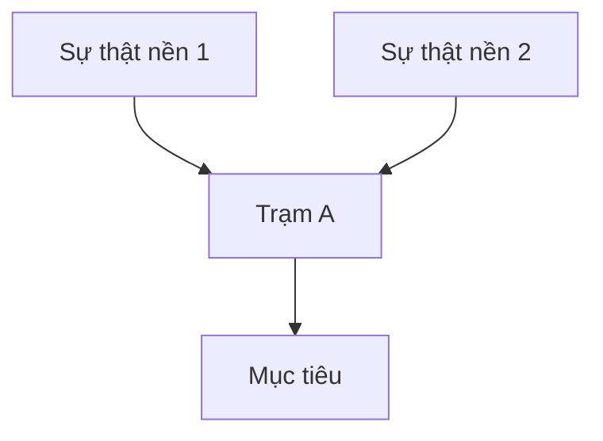

# Cấu trúc thư mục `hoc/`

Skill `hoc` tạo cấu trúc này trong thư mục làm việc khi người dùng bắt đầu chủ đề đầu tiên. Mọi skill `hoc-*` đọc và ghi vào đây.

```
hoc/
├── nhat-ky.md                 # mỗi buổi một dòng: ngày, chủ đề, giai đoạn, đã làm gì, việc tiếp theo
├── menh-de.md                 # "đồ thị kiến thức": mệnh đề và chuỗi suy luận đã dạy, mọi chủ đề
└── chu-de/<slug>/             # slug: chữ thường không dấu, nối bằng gạch ngang (vd: thong-ke-hoi-quy)
    ├── muc-tieu.md            # mục tiêu cụ thể, giai đoạn hiện tại
    ├── nguoi-hoc.md           # kết quả đo: từng mạch, sàn, trần, hiểu lầm; cập nhật suốt quá trình
    ├── ban-do.md              # bản đồ phụ thuộc (mermaid) + nút đang học
    └── buoi/<yyyy-mm-dd>.md   # biên bản buổi: câu hỏi, câu trả lời, độ tự tin, suy nghĩ, kết luận
```

## Mẫu `muc-tieu.md`

```markdown
# <Tên chủ đề>

- Giai đoạn: do | ke-hoach | day | luyen
- Bắt đầu: <yyyy-mm-dd>
- Nút đang học: <slug nút trên bản đồ, hoặc —>

## Mục tiêu (cụ thể)
Sau khi học xong, tôi làm được: …

## Vì sao học
…

## Tài liệu của người học
- <đường dẫn file / link, nếu có>
```

## Mẫu `nguoi-hoc.md`

```markdown
# Bức tranh người học: <chủ đề>

| Mạch | Sàn (chắc chắn đúng) | Trần (sai / không biết) | Hiểu lầm | Xây từ đâu |
|---|---|---|---|---|
| … | … | … | … | … |

## Ghi chú về cách nghĩ
- <cách họ tiếp cận, điều họ coi là hiển nhiên, chỗ hay đoán; kèm ngày>
```

## Mẫu `ban-do.md`

````markdown
# Bản đồ: <chủ đề>



- Nút đang học: `buoc-a`
- Đã đi qua: `nen-1`, `nen-2`

## Lịch sử thay đổi
- <yyyy-mm-dd>: <thay đổi gì, vì sao>
````

Quy tắc slug của nút: chữ thường a–z, số, gạch ngang. Đặt một lần, không đổi về sau. `A --> B` nghĩa là phải hiểu A trước B.

## Mẫu `buoi/<yyyy-mm-dd>.md`

```markdown
# Buổi <yyyy-mm-dd>: <chủ đề> (<giai đoạn>)

### <nút> · <đoán|kiểm tra|đo|luyện>
- Hỏi: …
- Trả lời: … · tự tin …% · suy nghĩ: "…"
- Kết luận: đúng/sai/một phần. <mô hình sai nào, nếu có> → <đi tiếp / vá / đo lại>
```

## Mẫu `menh-de.md`

```markdown
# Mệnh đề đã học

## <chủ đề>
- **M1** <mệnh đề, một câu khẳng định> · nguồn: buoi/2026-11-08 · luyện gần nhất: —
- **M2** …
- **C1** M1 + M2 ⟹ M3 (chuỗi suy luận: các tiền đề *cùng nhau* dẫn đến kết luận)
```

Mệnh đề ghi lại **ý tưởng và mối nối**, không phải điểm số năng lực. Có mệnh đề trong file không có nghĩa là người học đã nắm nó.

## Mẫu `nhat-ky.md`

```markdown
| Ngày | Chủ đề | Giai đoạn | Đã làm | Tiếp theo |
|---|---|---|---|---|
| 2026-11-08 | viet-theo-pinker | do | Đo 2 mạch: phong cách cổ điển, mạch lạc | Lập bản đồ |
```
